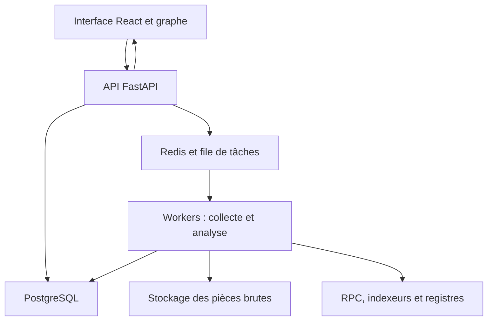

# Architecture et feuille de route — Plateforme d’investigation blockchain

**Document de conception, révision du 4 novembre 2026.**

Ce document définit une architecture cible et un découpage d’implémentation pour Codex. Il ne décrit pas un logiciel déjà développé ni des performances mesurées. Les objectifs de performance devront être validés par des mesures. Les technologies constituent des choix proposés ; les versions exactes seront sélectionnées, vérifiées et verrouillées au démarrage du dépôt.

## 1. Objectif et contrat scientifique

Construire une application web permettant, à partir d’une transaction d’incident ou d’une adresse et d’une période, de reconstituer les mouvements de valeur observables, d’identifier les transformations d’actifs et de proposer des pistes de continuation justifiées. L’investigateur doit pouvoir inspecter chaque preuve, corriger une annotation et exporter une analyse reproductible.

La question métier est : « Quelles opérations expliquent le parcours de la valeur issue de cet incident, sur les réseaux et protocoles couverts, et où la preuve devient-elle insuffisante ? »

Trois éléments doivent rester séparés :

1. **Observation** : un transfert, un événement de swap ou une exécution de message est présent dans une transaction canonique.
2. **Attribution** : une adresse serait liée à une organisation ou plusieurs adresses à un même contrôleur, selon une source et une méthode documentées.
3. **Allocation analytique** : une fraction d’un paiement est rattachée à la valeur étudiée selon une convention explicite de mélange des fonds.

Un lien de transfert ne prouve pas un contrôle commun. Une interaction avec une adresse signalée ne prouve pas une participation à une attaque. Une ressemblance de montant et d’horaire ne prouve pas une continuation inter-chaînes. L’absence de label ne signifie pas qu’une adresse est sûre.

Après un échange d’ETH contre des USDC, il ne s’agit plus du « même token ». Le moteur suit une relation de transformation de valeur, établie par les opérations du protocole, et conserve les quantités propres à chaque actif.

### 1.1 Limites de visibilité

| Situation | Ce que le moteur peut établir | Ce qu’il ne doit pas affirmer automatiquement |
|---|---|---|
| Transfert sur une chaîne couverte | Source, destination, actif, montant et position dans la chaîne | Identité humaine ou intention des parties |
| Swap sur un protocole couvert | Entrées, sorties et opérations vérifiées de la transaction | Attribution universelle de toutes les sorties dans un routeur arbitraire |
| Bridge couvert | Relation source/destination selon les messages et règles du protocole | Relation fondée uniquement sur une proximité temporelle |
| Dépôt sur une plateforme centralisée | Arrivée à une adresse attribuée à cette plateforme, selon le label disponible | Trade interne, identité du client et retrait correspondant |
| Mixeur ou dispositif de confidentialité | Entrée et activité publiquement observables ; candidats éventuels | Correspondance certaine entrée/sortie sans preuve supplémentaire |
| Réseau ou protocole non couvert | Frontière explicite de couverture et éléments bruts disponibles | Absence de continuation des fonds |

Le cas « dépôt Binance → swap Binance → retrait Base » contient donc une partie potentiellement hors chaîne. La plateforme doit représenter cette rupture. Des données fournies par la plateforme ou une procédure autorisée peuvent apporter des éléments supplémentaires ; elles ne sont pas accessibles par le seul graphe public. Binance décrit un canal dédié aux demandes des autorités [S6].

## 2. Définition de la V1.0

### 2.1 Périmètre proposé

| Domaine | V1.0 | Extension après V1.0 |
|---|---|---|
| Réseaux | Ethereum, Base, Arbitrum One | Optimism, BNB Chain, Polygon, puis adaptateurs non EVM |
| Actifs | ETH, WETH et transferts ERC-20 standard | NFT, actifs à rebase, jetons à taxes et cas non standards approfondis |
| Swaps | Uniswap v2/v3 sur les déploiements effectivement validés | Uniswap v4, Curve, Balancer, agrégateurs et autres DEX |
| Inter-chaînes | CCTP/USDC, versions et couples de réseaux validés séparément | Across, bridges natifs, autres messageries et routes |
| Entités | Registre vérifié limité, labels utilisateurs privés, imports officiels de sanctions | Fournisseurs spécialisés sous licence et validation communautaire modérée |
| Analyse | Parcours amont/aval, dispersion, convergence, cycles, allocation explicite | Modèles probabilistes évalués et investigations inter-familles de chaînes |
| Interface | Graphe, chronologie, table, dossier, filtres, preuves, export | Collaboration avancée et API développeur étendue |
| Accès | Site public ; dossiers privés ; calculs soumis à quotas | Accès institutionnel et déploiement autonome |

Les trois réseaux sont une cible de produit, pas une affirmation que tous les protocoles et toutes leurs versions y sont disponibles. Un registre de capacités validera les déploiements, blocs de début, ABI, versions, types de traces et limites des fournisseurs pour chaque réseau.

Bitcoin requiert un adaptateur UTXO et des règles de change/agrégation spécifiques ; Solana requiert un modèle d’instructions, d’instructions internes et de comptes de tokens ; Tron requiert son propre adaptateur. Les prévoir dans les interfaces ne signifie pas les prendre en charge en V1.

### 2.2 Parcours d’acceptation central

Une transaction de départ est sélectionnée. L’outil retrouve ses transferts, décode un swap pris en charge, suit une dispersion vers plusieurs adresses, reconnaît un transfert CCTP vers un second réseau, puis une convergence et un éventuel dépôt vers une entité connue. Chaque étape référence ses preuves ; chaque branche non résolue reste visible.

## 3. Architecture technique

### 3.1 Choix retenus

Le backend sera un **monolithe modulaire Python**, exécuté sous forme d’API et de workers séparés à partir du même code métier. Le frontend sera une application React/TypeScript. Cette organisation conserve une frontière claire entre présentation, collecte et analyse, sans imposer dès le départ une infrastructure de microservices.

| Couche | Choix | Rôle et justification |
|---|---|---|
| Interface | React, TypeScript, Vite | Application d’investigation ; rendu client et distribution statique |
| Graphe | Cytoscape.js | Sélection, regroupements, navigation et dispositions de graphe [S8] |
| État distant | TanStack Query | Cache des résultats API, pagination et invalidation |
| API | FastAPI et Pydantic | Contrats typés, validation et OpenAPI |
| Accès aux données | SQLAlchemy et Alembic | Modèles, transactions et migrations |
| Collecte EVM | HTTPX, web3.py et eth-abi | Appels RPC, décodage et intégration de fournisseurs derrière des adaptateurs |
| Tâches longues | Celery et Redis | Collecte, décodage et expansion hors des requêtes HTTP |
| Base principale | PostgreSQL | Dossiers, observations normalisées, opérations, labels, adjacences et état durable des tâches |
| Données brutes | Stockage objet compatible S3 | Réponses utiles, manifests et exports, avec versionnement/rétention configurés |
| Authentification | Fournisseur OIDC | Comptes, sessions et intégration d’identité sans gestion artisanale des mots de passe |
| Observabilité | OpenTelemetry, métriques et journaux structurés | Latences, erreurs, quotas et suivi d’un job de bout en bout |
| Développement | Docker Compose, pytest, Playwright | Environnement reproductible et validation des parcours métier |

Les bibliothèques non indispensables peuvent être ajoutées au jalon où elles deviennent utiles. Le choix du fournisseur OIDC, du RPC/indexeur et de l’hébergeur dépendra du budget et des conditions contractuelles.

### 3.2 Topologie



L’API valide l’autorisation et le budget, crée un job durable, puis renvoie un identifiant. Les workers mettent progressivement les résultats à disposition. L’interface suit l’avancement par SSE, avec reprise et interrogation périodique de secours. Les calculs ne dépendent pas du maintien d’une connexion navigateur.

### 3.3 Pourquoi PostgreSQL avant une base graphe dédiée

Le problème initial est de produire des relations correctes, sourcées et temporelles. Une table d’arêtes bien indexée permet de commencer les expansions bornées et les requêtes d’adjacence. L’algorithme maintient sa frontière et son état dans le moteur, au lieu de lancer une requête récursive illimitée.

Une base graphe pourra servir de projection de lecture si les mesures révèlent un besoin de traversées plus complexes. ClickHouse pourra accueillir des agrégations massives si leur charge justifie un stockage analytique distinct. PostgreSQL et les pièces brutes resteront la référence ; aucune double écriture non transactionnelle ne sera introduite sans journal de réplication et mécanisme de reprise.

## 4. Acquisition et qualité des données

### 4.1 Deux usages complémentaires

**Découverte** : un indexeur d’historique par adresse identifie les transactions candidates dans une fenêtre. Etherscan V2 fournit notamment un historique par adresse avec bornes de blocs et pagination [S2]. Il faut traiter les plafonds de résultats par découpage de périodes, et non interpréter une page limitée comme un historique complet.

**Vérification** : les transactions pertinentes sont enrichies avec blocs, reçus, logs et, si disponibles, traces d’exécution. `eth_getLogs` filtre des événements ; il ne constitue pas un moteur universel d’historique des adresses [S1]. Les mouvements natifs internes nécessitent des traces ou un index équivalent ; Geth documente notamment `callTracer` [S3].

Les sous-graphes de protocoles peuvent accélérer la découverte et servir de source complémentaire. Celui d’Uniswap v3 expose des événements de swap [S4]. Les assertions importantes sont rattachées aux transactions et événements sous-jacents, avec leurs limites de vérification.

### 4.2 Contrat d’adaptateur

Chaque fournisseur expose des capacités explicites : réseaux, blocs disponibles, historique par adresse, logs, traces, pagination, finalité, coût et quotas. Les interfaces métier minimales sont :

```text
get_capabilities(chain)
discover_address_activity(address, block_range, cursor)
get_transaction_bundle(chain, tx_hash)
get_logs(chain, filter, cursor)
get_chain_head_and_finality(chain)
```

Chaque réponse indique la source, l’heure de récupération, la plage couverte, le curseur et les éventuelles limites. Un résultat vide et une collecte incomplète sont deux états différents.

Le remplacement d’un fournisseur nécessite une équivalence de capacité déclarée. Un second RPC ne remplace pas automatiquement un index d’historique par adresse.

### 4.3 Canonicalité et finalité

Conserver `chain_id`, numéro et hash du bloc, hash parent, ordre de transaction et ordre des logs/traces. Les clés des observations incluent le hash du bloc et leur position afin de conserver aussi les observations devenues orphelines.

Lors d’une réorganisation : détecter le point de divergence, invalider la projection canonique concernée, recalculer les opérations et allocations dépendantes, et marquer les anciens rapports comme snapshots historiques. Une transaction redevenue canonique dans un autre bloc est une nouvelle observation de son inclusion.

La politique de finalité est propre à chaque chaîne et au bridge. Les tags `safe` et `finalized`, lorsqu’ils sont disponibles et correctement pris en charge, sont utiles [S1]. Le nombre de confirmations L2, la publication sur L1 et la finalisation ne doivent pas être fusionnés dans un booléen universel.

## 5. Modèle de données

### 5.1 Séparer observations, opérations et analyses

| Ensemble | Objets essentiels |
|---|---|
| Couverture | `chains`, `provider_capabilities`, `coverage_ranges`, `sync_cursors` |
| Pièces et chaîne | `source_snapshots`, `raw_artifacts`, `blocks`, `transactions`, `receipts`, `logs`, `call_traces` |
| Normalisation | `addresses`, `assets`, `movements`, `protocol_deployments`, `operations`, `operation_movements`, `bridge_links` |
| Enrichissement | `entities`, `label_assertions`, `entity_memberships`, `sanction_list_versions` |
| Investigation | `cases`, `case_seeds`, `analysis_runs`, `allocations`, `hypotheses`, `annotations`, `graph_views` |
| Exploitation | `jobs`, `outbox`, `audit_events`, `watchlists`, `exports` |

Une opération peut avoir plusieurs entrées et sorties. Les liens `operation_movements` évitent de réduire un routeur complexe à une seule arête. Dans la vue détaillée, un nœud d’opération joue le rôle de relation multiple entre les mouvements.

### 5.2 Identités et quantités

- Adresse : espace de noms de chaîne + octets de l’adresse ; format d’affichage conservé séparément. Une même chaîne hexadécimale sur deux réseaux ne suffit pas à établir un contrôle commun.
- Actif : réseau + adresse du contrat, ou identifiant natif. Le symbole `USDC` n’est pas une clé d’identité.
- Montant brut EVM : entier Python et `NUMERIC(78,0)` avec contrainte `0 <= amount <= 2^256-1`. Les agrégats peuvent nécessiter un domaine plus large. PostgreSQL fournit des numériques exacts [S9].
- API : montants sérialisés comme chaînes décimales ; aucune conversion par `Number` JavaScript pour les calculs.
- Décimales : métadonnées sourcées, éventuellement inconnues. Leur absence ne bloque pas la conservation du montant brut.
- Mouvement : référence au bloc, à la transaction et au log ou chemin de trace ; origine explicite `top_level`, `trace` ou `log`.
- Opération : type, protocole, version du décodeur, pièces utilisées et état de décodage.

Le transfert natif de premier niveau et la racine d’une trace peuvent représenter la même valeur : ils ne doivent pas être comptés deux fois. Les appels annulés et transactions échouées ne créent pas de transfert effectif ; les frais effectivement payés sont traités séparément.

### 5.3 Assertions et provenance

Une assertion de label contient au minimum : sujet, prédicat, valeur, source, référence de preuve, date d’observation, période de validité connue, date de collecte, méthode, statut de revue, version et auteur éventuel. La validité réelle et la période de connaissance par l’outil sont distinctes.

Les labels contradictoires sont conservés comme assertions concurrentes. L’annotation d’un utilisateur n’écrase pas la source officielle et ne devient pas publique sans publication explicite.

### 5.4 Reproductibilité

Un `analysis_run` fige les graines, paramètres, bornes de blocs, hashes, politiques d’allocation, versions de décodeurs, snapshots de labels et limites de couverture. Un rapport référence cet identifiant et un manifest des pièces avec leurs empreintes.

Une empreinte prouve l’intégrité relative à un contenu conservé, pas la véracité initiale de ce contenu ni une chaîne de possession juridiquement qualifiée. Stockage versionné, journalisation des accès et signatures de manifests peuvent renforcer l’auditabilité.

## 6. Moteur de reconstruction

### 6.1 Graines et fenêtre d’investigation

Privilégier une transaction et un mouvement de départ explicites, éventuellement plusieurs. Pour une adresse seule, l’utilisateur choisit une période et les entrées étudiées ; le moteur ne considère pas implicitement tout son solde comme issu de l’incident.

Chaque exécution fixe la direction, la profondeur maximale, les chaînes, actifs, périodes, seuils, limites de nœuds, temps et appels fournisseur. Toute limite atteinte génère une frontière visible et un point de reprise.

### 6.2 Pipeline

1. Découvrir les transactions candidates et mesurer la couverture effective.
2. Collecter les pièces et vérifier leur cohérence avec la chaîne retenue.
3. Normaliser les mouvements sans perdre leur position ni leurs références.
4. Reconnaître les opérations sur des déploiements vérifiés et décoder leurs effets.
5. Enrichir les adresses et opérations par des assertions sourcées.
6. Parcourir les relations pertinentes en respectant causalité, budgets et politiques d’arrêt.
7. Calculer séparément les allocations et hypothèses propres au dossier.
8. Construire graphe, chronologie, résumés et pièces exportables.

Sur une chaîne, l’ordre de bloc, de transaction et d’exécution prévaut sur une simple heure. Entre chaînes, les messages de protocole fournissent une relation causale ; des horloges proches ne suffisent pas.

### 6.3 Swaps

Le décodeur combine événements des pools, identité du déploiement, transferts, traces utiles et bénéficiaires effectifs. Un nom de fonction ou une signature d’événement peut être imité par un contrat : vérifier l’origine du pool et son déploiement. Les événements v2 sont documentés dans les contrats officiels [S10].

Un routeur peut exécuter plusieurs swaps, rembourser un surplus ou utiliser une balance préexistante. La V1 doit distinguer les routes simples résolues des opérations composites partiellement décodées. Les champs `sender`, `recipient` et l’initiateur de transaction ne sont pas nécessairement le bénéficiaire économique final.

Lors d’un swap identifié, le moteur poursuit les sorties liées à l’opération. Il ne propage pas l’attribution à tous les utilisateurs futurs du pool. Les dépôts de liquidité, emprunts, wrappers et agrégateurs non couverts restent des opérations explicites, sans transformation inventée.

### 6.4 Inter-chaînes

Un adaptateur par protocole et par version interprète ses preuves. Pour CCTP, la reconstruction concerne un burn et un mint d’USDC reliés au mécanisme de message ; elle doit vérifier domaines, destinataire et exécution sur les contrats attendus [S5].

Ne pas implémenter une égalité naïve universelle entre nonces source et destination : CCTP a des différences de version, et sa documentation actuelle décrit des nonces attribués hors chaîne. L’adaptateur doit utiliser le format et les informations d’attestation de la version concernée, puis rattacher la réception observée. Il reste strictement en lecture ; il ne soumet aucune transaction ni demande de ré-attestation.

États : `source_seen`, `awaiting_evidence`, `destination_verified`, `expired_or_failed_if_proven`, `unsupported_version`, `unresolved`. Le mot « échoué » exige une preuve ; un timeout local signifie seulement « non résolu dans la collecte actuelle ».

### 6.5 Mélange des fonds et allocation

Dans un compte contenant des actifs fongibles, une sortie ne possède généralement pas d’identité individuelle permettant de distinguer matériellement les unités reçues. Le graphe des mouvements observés et le graphe de valeur attribuée doivent donc être séparés.

Politique V1 proposée : **allocation proportionnelle**, avec FIFO comme scénario alternatif uniquement si son implémentation est testée. Pour un même actif, juste avant une sortie :

```text
fraction_attribuée = solde_attribué / solde_total
sortie_attribuée = montant_sortant × fraction_attribuée
```

Exemple : une adresse contient 20 USDC attribués au dossier et 80 autres USDC. Une sortie de 30 USDC reçoit une allocation de 6 USDC selon cette politique. Ce résultat est une convention analytique, pas une observation prouvant quelles unités ont été dépensées.

Le calcul exige un solde de départ connu et les mouvements ordonnés pertinents. Si cette couverture manque, l’allocation est « indéterminée » ou conditionnelle ; un montant précis n’est pas fabriqué. Utiliser des rationnels ou une précision contrôlée avec règle explicite de résidu ; ne jamais créer de valeur par arrondi.

Les frais, destructions, remboursements et émissions sont comptabilisés selon l’actif. Un échange change l’unité de compte : on ne somme pas ETH et USDC. Les éventuels équivalents monétaires utilisent une source et une date de prix distinctes, et restent des estimations.

### 6.6 Dispersion, convergence et cycles

Détecter et présenter : fractionnement d’une valeur vers plusieurs sorties, regroupement vers une destination, passages rapprochés entre actifs/réseaux, chaînes de transferts répétitives et retours cycliques. Les seuils sont configurables, versionnés et décrits.

Ces motifs sont des priorités d’examen. Ils ne démontrent pas seuls un blanchiment, une attaque ou une entité commune. Une convergence ne permet pas de fusionner toutes les branches comme si elles avaient nécessairement le même propriétaire.

Pour maîtriser les cycles, l’état visité comprend le réseau, l’actif, la position temporelle et l’état analytique pertinent ; une simple liste d’adresses déjà vues empêcherait de suivre un retour légitime. Les mouvements sources sont comptés une fois par exécution, même si plusieurs chemins les atteignent.

## 7. Labels, listes et confiance

Quatre catégories séparées sont nécessaires : liste officielle de sanctions, signalement d’incident, attribution à une entité et annotation privée d’investigation. Les interdictions inscrites dans un contrat de token constituent encore une autre catégorie, liée à un contrat et un état de chaîne.

OFAC permet la recherche exacte d’adresses et fournit des listes téléchargeables [S7]. Le moteur doit enregistrer la liste, sa date de collecte, sa version et le périmètre connu de l’identifiant. Il ne doit pas transformer automatiquement une mention d’adresse en attribution à tous les réseaux où les mêmes octets apparaissent. Une collecte échouée conserve le dernier snapshot en le marquant périmé.

Pour les exchanges et autres services : registre initial restreint, preuves publiques officielles quand disponibles, imports contractuellement autorisés et validation manuelle. Les conditions de réutilisation, de mise en cache et de redistribution des labels doivent être vérifiées avant la publication de leurs données.

Séparer dans l’interface :

- statut de preuve du lien : observé, décodé, corroboré ou hypothétique ;
- crédibilité et validité du label : source et revue ;
- exposition de la valeur selon la politique d’allocation ;
- signal de risque expliqué par des facteurs, sans verdict automatique.

La V1 n’affiche pas une probabilité de 97 % issue d’un barème arbitraire. Si un modèle probabiliste est ajouté, son protocole d’évaluation et sa calibration devront être publiés. Un LLM éventuel résume uniquement les faits structurés et cite les identifiants de preuves ; il n’invente pas les relations et ne calcule pas les allocations.

## 8. Exécution fiable et performance

### 8.1 Tâches et reprise

L’état autoritatif d’un job est dans PostgreSQL : `queued`, `running`, `partial`, `completed`, `failed`, `cancelled`, plus checkpoint et heartbeat. `partial` contient une cause et un curseur de continuation.

Une transaction enregistre le job et un événement d’outbox. Un dispatcher transmet l’événement à Celery ; un réconciliateur relance les jobs bloqués ou non remis. Les tâches peuvent être livrées plusieurs fois : clés d’idempotence, contraintes uniques, verrous courts, checkpoints et bornes de retry rendent cette situation normale. La documentation Celery rappelle la nécessité d’idempotence et les nuances des acquittements [S11].

Redis n’est ni la référence des investigations ni la seule preuve de l’existence d’un job. L’annulation est vérifiée entre lots ; un worker interrompu reprend au dernier checkpoint valide. Les queues interactives et historiques ont des budgets distincts pour éviter qu’un gros backfill bloque toutes les analyses.

### 8.2 Éviter l’explosion du graphe

Stratégie : collecte à la demande et cache partagé des faits publics autorisés, indexation proactive limitée aux protocoles et watchlists retenus. Pas d’indexation universelle de toutes les chaînes au démarrage.

Valeurs de départ proposées : profondeur 5, 500 nœuds visibles, 1 500 arêtes visibles, expansions supplémentaires paginées. Le graphe de calcul peut être plus large ; les limites d’affichage n’effacent pas les faits conservés. Les routes par exchange, mixeur et protocole inconnu génèrent des frontières plutôt qu’une expansion aveugle.

Indexer les adjacences par réseau, adresse, actif et position de bloc. Dédupliquer les requêtes concurrentes ; adapter les plages de logs, limiter la concurrence par fournisseur et respecter les réponses de limitation. Séparer les caches de faits publics des vues privées et inclure les versions pertinentes dans les clés de cache.

### 8.3 Objectifs à mesurer

| Indicateur | Objectif initial proposé | Conditions de mesure |
|---|---|---|
| Lecture d’un sous-graphe déjà calculé | p95 inférieur à 2 s côté API | 500 nœuds / 1 500 arêtes, machine et concurrence documentées |
| Création d’un job | p95 inférieur à 500 ms | Hors file de calcul et latence des fournisseurs |
| Affichage progressif | Premiers résultats dès un lot exploitable | Pas d’attente de la reconstruction complète |
| Résultats sans cache | Latence publiée par périmètre | Volume, profondeur, quotas et couverture enregistrés |
| Coût d’analyse | Mesuré par appels, stockage et CPU | Budget maximal et reprise explicite par dossier |

Aucune promesse de traçage universel en quelques secondes. Les benchmarks doivent distinguer cache chaud, collecte froide et analyses partiellement couvertes.

## 9. API et expérience d’investigation

### 9.1 Contrats minimaux

| Route | Fonction |
|---|---|
| `GET /api/v1/capabilities` | Réseaux, protocoles, versions et limites effectives |
| `POST /api/v1/cases` | Créer un dossier privé avec graines |
| `POST /api/v1/cases/{id}/runs` | Démarrer une analyse, avec clé d’idempotence |
| `GET /api/v1/jobs/{id}` | Avancement, état, limites et checkpoint |
| `POST /api/v1/jobs/{id}/cancel` | Demander l’annulation |
| `GET /api/v1/runs/{id}/events` | Flux SSE autorisé et reprenable |
| `GET /api/v1/runs/{id}/graph` | Sous-graphe filtré et paginé |
| `POST /api/v1/runs/{id}/expansions` | Expansion bornée ; nouveau calcul ou révision explicite |
| `GET /api/v1/operations/{id}` | Détails, mouvements et preuves |
| `GET /api/v1/addresses/{chain}/{address}/labels` | Assertions avec provenance |
| `POST /api/v1/cases/{id}/annotations` | Annoter sans altérer les observations |
| `POST /api/v1/runs/{id}/exports` | Générer un snapshot exportable |

Chaque résultat distingue `complete_within_declared_scope`, `partial`, `unsupported` et `unknown`. Il renvoie la couverture, les causes d’arrêt, la finalité et les références de preuves. La complétude porte sur les sources et types d’activité déclarés, jamais sur toutes les activités économiques possibles.

### 9.2 Écran principal

Une recherche d’adresse ou de transaction ouvre un dossier. L’en-tête montre réseaux, période, politique d’allocation et couverture. Le centre contient le graphe ; un panneau latéral affiche l’opération sélectionnée et ses preuves ; une zone synchronisée propose chronologie et table accessibles.

La vue métier regroupe le bruit technique en opérations. La vue détaillée expose les contrats, transferts et appels. Les marqueurs de réseau, badges de preuve et styles d’arêtes empêchent de confondre transfert, transformation et hypothèse. La couleur seule ne porte aucune information essentielle.

Fonctions V1 : épingler une adresse, filtrer les petits mouvements sans les supprimer des données, sélectionner un chemin, grouper par entité avec avertissement de provenance, ouvrir l’explorateur du réseau, reprendre une branche et exporter JSON/CSV/HTML. L’HTML fournit un rapport imprimable ; un PDF dédié peut être ajouté après validation de sa mise en page.

## 10. Sécurité, accès public et exploitation

L’outil est en lecture : aucune clé privée, signature de transaction ou connexion de wallet n’est nécessaire à l’investigation. Les clés des fournisseurs restent côté serveur. Les endpoints RPC sont configurés par l’administration ; accepter une URL arbitraire d’utilisateur créerait notamment un risque de SSRF et de coût incontrôlé.

Un site accessible à tous peut proposer une démonstration et des recherches bornées anonymes ; les calculs lourds et la conservation de dossiers demandent un compte et des quotas. La visibilité publique du site n’implique pas la publication des dossiers. Tout partage nécessite un choix explicite ; les liens de partage sont révocables et les exports privés restent protégés.

L’autorisation est vérifiée côté serveur sur chaque dossier, run, export, flux SSE et annotation. Isoler les tenants, éviter les fuites par cache, tester les accès croisés et les identifiants devinables. PostgreSQL RLS peut compléter cette défense si son contexte est correctement propagé avec le pool de connexions.

Considérer métadonnées de tokens, ABI importées, annotations et contenus externes comme non fiables : validation de taille, échappement, CSP, protection des exports CSV contre les formules, liens sortants contrôlés et limite des décodages. Les pièces brutes et traces peuvent contenir des charges très volumineuses.

Déploiement proposé : frontend statique derrière TLS/CDN ; API et workers en conteneurs ; PostgreSQL et Redis privés ; stockage objet privé. Environnements développement, préproduction et production séparés. CI : contrôles, migrations, tests métier, build, analyse des dépendances et déploiement versionné. Sauvegardes PostgreSQL, sauvegarde des pièces, restauration testée et rollback applicatif accompagné d’une stratégie de migration.

L’exposition publique exige également une politique de rétention des dossiers, des journaux et des annotations, ainsi qu’une vérification des droits de diffusion des données enrichies. Ces éléments découlent du produit et des fournisseurs choisis ; ils ne constituent pas une qualification juridique universelle des adresses.

## 11. Validation scientifique et logicielle

### 11.1 Corpus de référence

Construire des fixtures locales et des snapshots de transactions publiques sélectionnées, avec résultats attendus revus manuellement. Les données live sont des tests d’intégration distincts : elles ne doivent pas rendre la CI dépendante d’un fournisseur externe à chaque commit.

Le corpus couvre : transfert simple ; appel interne ; annulation ; wrap/unwrap ; swap simple et multihop ; routeur avec remboursement ; dispersion ; convergence ; cycle ; CCTP réussi, en attente et version inconnue ; dépôt vers exchange ; label contradictoire ; token trompeur ; pagination tronquée ; RPC indisponible ; réorganisation ; redelivery de tâche ; accès croisé entre utilisateurs.

Les scénarios synthétiques vérifient les invariants ; les transactions réelles vérifient les décodeurs dans leurs contextes effectivement pris en charge. Une fixture inventée ne valide pas à elle seule le fonctionnement sur un protocole réel.

### 11.2 Invariants

1. Aucun double comptage entre trace racine et transfert natif de premier niveau.
2. Aucune attribution supérieure au montant observé ; conservation dans le domaine et selon le modèle déclaré, frais et transformations explicités.
3. Aucun lien inter-chaînes certain fondé seulement sur un montant et un délai.
4. Aucune continuation certaine à travers les écritures internes d’un exchange sans preuve adaptée.
5. Toute assertion affichée référence une source ou une règle analytique versionnée.
6. Toute troncature, couverture manquante et version inconnue sont visibles.
7. Rejouer une collecte ou redélivrer une tâche n’ajoute pas de doublons.
8. Une réorganisation invalide les dérivations concernées sans effacer l’historique d’observation.
9. Un utilisateur ne lit ni dossier, ni export, ni flux privé d’un autre.
10. Un même snapshot et les mêmes paramètres produisent les mêmes résultats déterministes.

Mesurer la précision et la couverture de reconnaissance des opérations sur le corpus annoté. Les liens exacts de protocole, les labels et les heuristiques ont des métriques distinctes ; les performances sur ce corpus ne démontrent pas une couverture universelle.

## 12. Feuille de route pour Codex

Un jalon doit rester utilisable et démontrable. La version suivante commence lorsque les critères de sortie sont satisfaits, ou après révision explicite du périmètre. L’ordre fait apparaître les difficultés de données avant d’investir dans une interface sophistiquée.

| Version | Livrable | Critère de sortie |
|---|---|---|
| **0.1 — Fondations** | Dépôt, Compose, migrations, contrats de données, API et interface minimales, mode démo explicite | Démarrage documenté depuis un clone ; montants exacts et séparation des trois couches validés |
| **0.2 — Ethereum réel** | Adaptateurs indexeur/RPC, historique borné, reçus/logs, transferts ETH/ERC-20, provenance | Transactions publiques du corpus correctement reconstruites ; pagination et collecte partielle testées |
| **0.3 — Exploration** | Jobs durables, checkpoints, graphe, chronologie, expansion amont/aval, limites | Dispersion, convergence et cycle explorables sans doublons ; reprise après interruption |
| **0.4 — Opérations EVM** | Traces, wrap/unwrap, Uniswap v2/v3, registry de déploiements, routes couvertes | Montants, remboursements et bénéficiaires validés sur fixtures réelles ; cas inconnus explicites |
| **0.5 — Premier parcours inter-chaînes** | Base et Arbitrum, adaptateur CCTP versionné, états source/destination | Au moins un trajet réel complet validé par couple de réseaux revendiqué ; aucune liaison naïve montant/temps |
| **0.6 — Enrichissement** | Versions de listes officielles, registre d’entités, labels contradictoires, annotations privées | Chaque badge est sourcé, daté et distinct d’une exposition indirecte |
| **0.7 — Attribution de valeur** | Allocation proportionnelle, soldes de départ, frontières exchange/mixeur, motifs | Conservation, mélanges, couverture incomplète et convergence testés ; aucune fausse certitude |
| **0.8 — Dossiers** | OIDC, droits, sauvegarde des vues, watchlists bornées, exports avec manifest | Reprise d’un dossier et export reproductible ; tests d’isolation et de notifications internes |
| **0.9 — Préproduction** | Site en préproduction, quotas, observabilité, réorgs, sécurité et restauration | Corpus de bout en bout, panne fournisseur, replay, restauration et benchmarks validés |
| **1.0 — Publication** | Site public selon l’audience choisie, documentation et matrice de couverture | Déploiement reproductible, limites visibles, corpus accepté, coûts et supervision observables |

Les watchlists V0.8 signalent les mouvements dans l’application. Les envois par email ou webhook relèvent d’une fonctionnalité explicitement configurée avec gestion des destinataires et des secrets.

### 12.1 Organisation du dépôt

Répertoires proposés : `apps/web`, `apps/api`, `src/investigation`, `src/connectors`, `src/decoders`, `src/workers`, `migrations`, `tests/fixtures`, `tests/integration`, `tests/e2e`, `docs/adr`, `docs/releases`, `infra`.

Le code métier Python est partagé par API et workers et reste indépendant de FastAPI/Celery autant que possible. Les schémas OpenAPI génèrent les types ou le client TypeScript. Les décisions importantes deviennent des ADR : modèle d’allocation, déploiements couverts, sélection de fournisseur, périmètre de cache et stratégie de finalité.

### 12.2 Instruction générale à placer dans le dépôt

```text
Construis la version demandée du projet conformément au document d’architecture.
Avant de modifier le code, lis l’état du dépôt, les ADR et la dernière version validée.
Implémente uniquement le jalon demandé et ses dépendances indispensables.
Sépare observations, opérations, labels et allocations analytiques.
N’affiche jamais une donnée simulée comme issue d’une collecte réelle.
N’invente aucun label d’entité, lien inter-chaînes, taux de confiance ou prix.
Préserve les preuves, la couverture et les états partiels dans l’API et l’interface.
Utilise des montants exacts et des décodeurs liés à des déploiements/version validés.
Ajoute les tests métier nécessaires au jalon et exécute-les.
Livre une démonstration reproductible, les migrations, la configuration documentée
et les limitations réelles dans docs/releases/vX.Y.md.
Si un fournisseur ou une clé manque, livre le connecteur et son état indisponible
explicite ; les fixtures doivent rester dans un mode démo clairement indiqué.
Ne déclare le jalon terminé que lorsque ses critères de sortie sont vérifiés.
```

### 12.3 Première demande d’implémentation

```text
Implémente uniquement la V0.1 du document architecture-tracage-blockchain-v1.md.
Crée le monolithe modulaire Python, l’API FastAPI, le frontend React/TypeScript,
PostgreSQL et Redis sous Docker Compose. Prépare les abstractions de fournisseurs
sans collecter ni indexer toutes les chaînes. Définis les identifiants multi-chaînes,
montants exacts, observations, opérations, dossiers et runs avec migrations initiales.
Ajoute un petit jeu de données synthétiques explicitement marqué « Démonstration »
pour parcourir l’interface minimale. Documente le lancement, les vérifications
effectuées et les critères encore non couverts. Ne commence pas la V0.2.
```

Pour les versions suivantes, remplacer le jalon et lui joindre sa ligne de critères, le dernier état validé et les ADR en vigueur. Codex ne doit pas réécrire arbitrairement l’architecture à chaque itération.

## 13. Coût, dépendances et risques de projet

Les principaux coûts sont l’historique indexé, les traces historiques, le volume d’appels, la conservation des pièces et l’acquisition éventuelle de labels. Le calcul local peut être secondaire face aux abonnements de données. Les prix ne sont pas estimés ici sans choix de fournisseur ni mesure d’usage.

Avant d’ouvrir largement le service, mesurer : appels moyens et p95 par dossier, octets conservés, durée CPU, taux de cache, analyses par utilisateur et fan-out des gros contrats. Appliquer des budgets configurables par analyse et par compte. Vérifier les droits de redistribution, la rétention permise et la dépendance à chaque fournisseur.

Le périmètre doit évoluer d’après trois preuves : un parcours métier utile, un corpus qui valide les opérations couvertes, et un coût d’exploitation mesuré. Les axes de recherche ultérieurs sont l’attribution probabiliste inter-chaînes, les motifs de regroupement et la calibration de confiance ; ils doivent être évalués séparément du noyau déterministe.

## 14. Sources techniques primaires

Sources consultées le 4 novembre 2026. Les recommandations d’architecture et objectifs de produit sont une synthèse de conception, non des prescriptions de ces sources.

- **[S1] Ethereum — JSON-RPC et logs.** [API JSON-RPC](https://ethereum.org/developers/docs/apis/json-rpc/) ; [spécification eth_getLogs](https://ethereum.github.io/execution-apis/next/api/methods/eth_getLogs/).
- **[S2] Etherscan — historique d’adresse.** [Get Normal Transactions By Address](https://docs.etherscan.io/api-reference/endpoint/txlist). La couverture et les quotas devront être vérifiés pour l’offre retenue.
- **[S3] Geth — traces d’exécution.** [Built-in tracers](https://geth.ethereum.org/docs/developers/evm-tracing/built-in-tracers).
- **[S4] Uniswap — indexation et swaps v3.** [v3 Queries](https://developers.uniswap.org/docs/ecosystem/subgraphs/concepts/v3/queries).
- **[S5] Circle — CCTP.** [Technical guide](https://developers.circle.com/cctp/references/technical-guide) ; [contrat MessageTransmitterV2](https://github.com/circlefin/evm-cctp-contracts/blob/master/src/v2/MessageTransmitterV2.sol).
- **[S6] Binance — accès aux informations dans les enquêtes.** [Government Law Enforcement Request System](https://www.binance.com/en/support/law-enforcement).
- **[S7] OFAC — filtrage d’adresses.** [FAQ 594](https://ofac.treasury.gov/faqs/594). Cette référence documente une source de listes ; elle ne constitue pas une analyse juridique de la situation d’un utilisateur.
- **[S8] Cytoscape.js — bibliothèque de graphe.** [Documentation officielle](https://js.cytoscape.org/).
- **[S9] PostgreSQL — types numériques exacts.** [Numeric Types](https://www.postgresql.org/docs/current/datatype-numeric.html).
- **[S10] Uniswap — source du protocole v2.** [UniswapV2Pair.sol](https://github.com/Uniswap/v2-core/blob/master/contracts/UniswapV2Pair.sol).
- **[S11] Celery — exécution des tâches et idempotence.** [Tasks](https://docs.celeryq.dev/en/stable/userguide/tasks.html).
